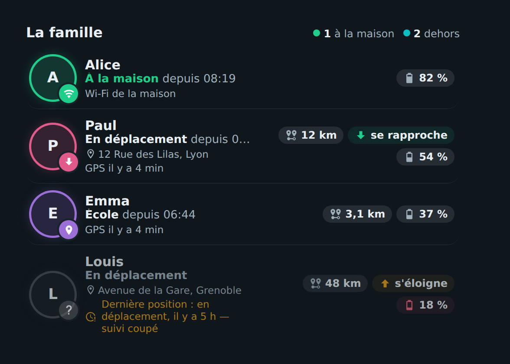

# 👨‍👩‍👧 HOLM Family Card

[](https://hacs.xyz/)


[🇫🇷 Français](README.md) · 🇬🇧 English

**Who is where, at a glance: at home, on the road, at school… with the distance, direction of travel and the phone's battery.**

HOLM Family Card shows family members from their **`person`** entities. For each one: an avatar ringed in their colour, the place and since when, the address, the location source (GPS or home Wi-Fi) and distance / direction / battery chips.

> ✨ **Zero YAML.** Pick the people in the visual editor: the phone's battery and address (Home Assistant app) and the **Proximity** integration's sensors are **found automatically**.

### At a glance

- 🏠 **Summary**: “1 at home · 2 out”.
- 📍 **Place**: Home Assistant zone (Home, School, Work…), “Away” with the address, and since what time.
- 🧭 **Proximity**: distance to home and direction of travel (getting closer, moving away, arrived).
- 📶 **Wi-Fi**: a phone connected to the home Wi-Fi (router tracker) counts as “at home”, even if GPS lags.
- ⏱️ **Location too old**: after an adjustable delay, the card no longer claims anything and shows “Last location … 5 h ago — tracking off”.
- 🔋 Phone battery (red below 20%), alert if the app stops responding.
- 👆 A tap opens the person's (or battery's) dialog.
- 🌍 **8 languages**: English, French, German, Spanish, Italian, Dutch, Portuguese and Polish.



*Screenshot in French — the card follows the language of your Home Assistant profile.*

### 🆕 What's new in 1.1.0

- 🌍 **The card speaks 8 languages**: English, French, German, Spanish, Italian, Dutch, Portuguese and Polish, editor included. It follows the language of your Home Assistant profile (English if your language isn't translated yet); the `language` option lets you force one.

---

## Installation

### With HACS (recommended)

1. HACS → ⋮ menu → **Custom repositories**.
2. Add `https://github.com/kaaribou/holm-family-card`, category **Dashboard** (*Plugin*).
3. Search for the card → **Download**.
4. Reload the page (Ctrl + F5).

### Manually

1. Copy `dist/holm-family-card.js` to `config/www/community/holm-family-card/`.
2. **Settings → Dashboards → ⋮ → Resources → Add**: `/local/community/holm-family-card/holm-family-card.js`, type **JavaScript module**.
3. Reload the page.

---

## Usage

```yaml
type: custom:holm-family-card
title: The family
persons:
  - entity: person.alice
  - entity: person.paul
    color: "#e05a8a"
    wifi: [device_tracker.paul_phone_wifi]
  - person.emma
```

## Options

| Option | Description | Default |
|---|---|---|
| `language` | Language: `fr`, `en`, `de`, `es`, `it`, `nl`, `pt`, `pl` | the profile's |
| `title` | Title | `The family` (in the card's language) |
| `persons` | List of people (**required**) | — |
| `stale_hours` | After this delay (hours), the GPS location is considered too old | `3` |
| `show_address` | Show the address when the person is out | `true` |
| `home_zones` | Extra zone names considered “at home” | — |
| `show_frame` | Show the card frame | `true` |

Each person accepts:

| Key | Description |
|---|---|
| `entity` | `person` entity (**required**) |
| `name` | Displayed name |
| `color` | Ring colour (otherwise a palette colour) |
| `wifi` | The phone's Wi-Fi (router) trackers |
| `battery`, `address`, `distance`, `direction` | Sensors to use if automatic detection doesn't find them |

Zones less than 250 m from the Home zone are also considered “at home”.

## FAQ

| Problem | Solution |
|---|---|
| No distance or direction | Add the **Proximity** integration (Settings → Devices & services) tracking the people you want. |
| No battery or address | Enable the “Battery level” and “Geocoded location” sensors of the phone's Home Assistant app. |
| The card is not in my language | Set `language` in the card, or open an issue to suggest a translation. |
| The new version doesn't show | Clear the cache (Ctrl + F5). |

---

## Say thanks?

Like the card? You can buy me a beer 🍺

[](https://paypal.me/kaaribou)

---

## License

Code: **MIT** license — © kaaribou. See the [CHANGELOG](CHANGELOG.md) (in French).

Part of **HOLM — Home Orchestration & Living Management**: smart management and orchestration of the home.

Other projects: [Carburant HOLM](https://github.com/kaaribou/carburant-holm) · [Climat HOLM](https://github.com/kaaribou/climat-holm) · [Volets HOLM](https://github.com/kaaribou/volets-holm) · [HOLM HP/HC](https://github.com/kaaribou/holm-tarif) · [HOLM Lektrico](https://github.com/kaaribou/lektrico-holm) · [HOLM LaMetric](https://github.com/kaaribou/lametric-holm) · [HOLM My Menu](https://github.com/kaaribou/holm-mymenu) · [HOLM Cars](https://github.com/kaaribou/holm-cars) · [HOLM GitHub](https://github.com/kaaribou/github-holm) · [HOLM Navbar Card](https://github.com/kaaribou/holm-navbar-card) · [HOLM Climate Card](https://github.com/kaaribou/climate-card-holm) · [HOLM Music Card](https://github.com/kaaribou/holm-music-card) · [HOLM Energy Cards](https://github.com/kaaribou/holm-energy-cards) · [HOLM Power Flow Card](https://github.com/kaaribou/holm-power-flow-card) · [HOLM Ecojoko Card](https://github.com/kaaribou/holm-ecojoko-card) · [HOLM Runtime Card](https://github.com/kaaribou/holm-runtime-card) · [HOLM Covers Card](https://github.com/kaaribou/holm-covers-card) · [HOLM Floor Card](https://github.com/kaaribou/holm-floor-card) · [HOLM Radiator Card](https://github.com/kaaribou/holm-radiator-card) · [HOLM Security Card](https://github.com/kaaribou/holm-security-card) · [HOLM Sentinel Card](https://github.com/kaaribou/holm-sentinel-card) · [HOLM Recordings Card](https://github.com/kaaribou/holm-recordings-card) · [HOLM Smoke Card](https://github.com/kaaribou/holm-smoke-card) · [HOLM Govee Light Card](https://github.com/kaaribou/holm-govee-light-card) · [HOLM Leapmotor Card](https://github.com/kaaribou/holm-leapmotor-card).
