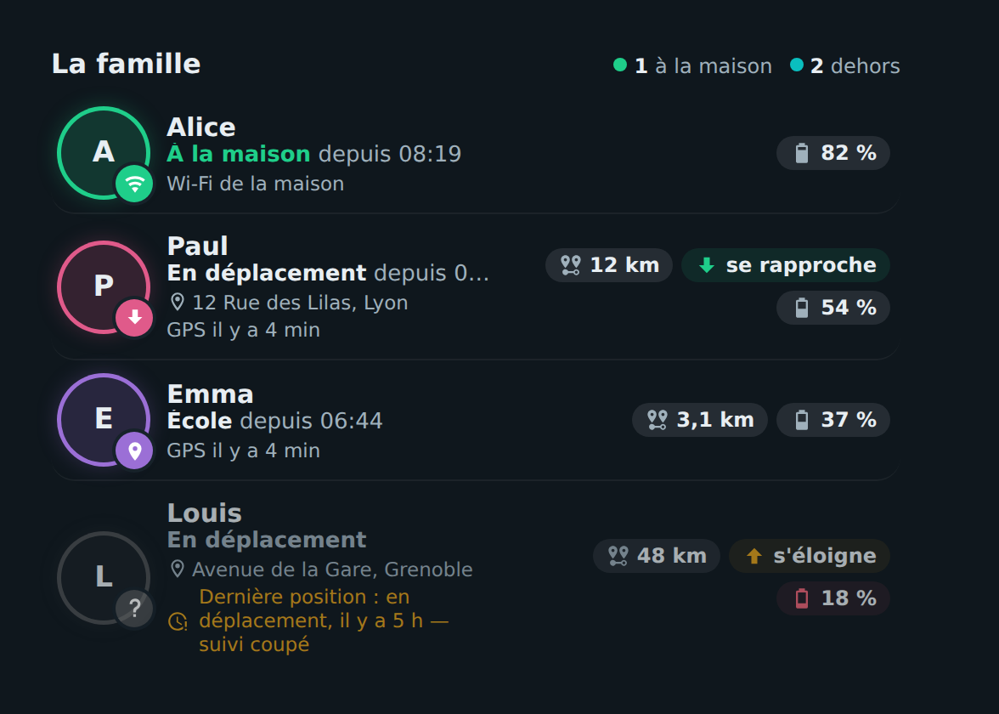

# 👨‍👩‍👧 HOLM Family Card

[](https://hacs.xyz/)


**Qui est où, en un coup d'œil : à la maison, en route, à l'école… avec la distance, le sens du trajet et la batterie du téléphone.**

HOLM Family Card affiche les membres de la famille à partir de leurs entités **`person`**. Pour chacun : un avatar entouré de sa couleur, le lieu et depuis quand, l'adresse, la source de la position (GPS ou Wi-Fi de la maison) et des pastilles distance / direction / batterie.

> ✨ **Zéro YAML.** On choisit les personnes dans l'éditeur visuel : batterie et adresse du téléphone (application Home Assistant) et capteurs de l'intégration **Proximité** sont **trouvés automatiquement**.

### En bref

- 🏠 **Résumé** : « 1 à la maison · 2 dehors ».
- 📍 **Lieu** : zone Home Assistant (Maison, École, Travail…), « En déplacement » avec l'adresse, depuis quelle heure.
- 🧭 **Proximité** : distance à la maison et sens du trajet (se rapproche, s'éloigne, arrivé).
- 📶 **Wi-Fi** : un téléphone connecté au Wi-Fi de la maison (traqueur du routeur) compte comme « à la maison », même si le GPS traîne.
- ⏱️ **Position trop ancienne** : au-delà d'un délai réglable, la carte n'affirme plus rien et affiche « Dernière position … il y a 5 h — suivi coupé ».
- 🔋 Batterie du téléphone (rouge sous 20 %), alerte si l'application ne répond plus.
- 👆 Un toucher ouvre la fiche de la personne (ou de la batterie).



---

## Installation

### Avec HACS (recommandé)

1. HACS → menu ⋮ → **Dépôts personnalisés**.
2. Ajoutez `https://github.com/kaaribou/holm-family-card`, catégorie **Tableau de bord** (*Dashboard / Plugin*).
3. Recherchez la carte → **Télécharger**.
4. Rechargez la page (Ctrl + F5).

### Manuellement

1. Copiez `dist/holm-family-card.js` dans `config/www/community/holm-family-card/`.
2. **Paramètres → Tableaux de bord → ⋮ → Ressources → Ajouter** : `/local/community/holm-family-card/holm-family-card.js`, type **Module JavaScript**.
3. Rechargez la page.

---

## Utilisation

```yaml
type: custom:holm-family-card
title: La famille
persons:
  - entity: person.alice
  - entity: person.paul
    color: "#e05a8a"
    wifi: [device_tracker.telephone_paul_wifi]
  - person.emma
```

## Options

| Option | Description | Par défaut |
|---|---|---|
| `title` | Titre | `La famille` |
| `persons` | Liste des personnes (**obligatoire**) | — |
| `stale_hours` | Au-delà de ce délai (heures), la position GPS est considérée comme trop ancienne | `3` |
| `show_address` | Afficher l'adresse quand la personne est dehors | `true` |
| `home_zones` | Noms de zones supplémentaires considérées comme « à la maison » | — |
| `show_frame` | Afficher le cadre de la carte | `true` |

Chaque personne accepte :

| Clé | Description |
|---|---|
| `entity` | Entité `person` (**obligatoire**) |
| `name` | Nom affiché |
| `color` | Couleur de l'anneau (sinon une couleur de la palette) |
| `wifi` | Traqueurs Wi-Fi (routeur) du téléphone |
| `battery`, `address`, `distance`, `direction` | Capteurs à utiliser si la détection automatique ne les trouve pas |

Les zones situées à moins de 250 m de la zone Maison sont aussi considérées comme « à la maison ».

## FAQ

| Problème | Solution |
|---|---|
| Pas de distance ni de direction | Ajoutez l'intégration **Proximité** (Paramètres → Appareils et services) en suivant les personnes voulues. |
| Pas de batterie ni d'adresse | Activez les capteurs « Niveau de batterie » et « Emplacement géocodé » de l'application Home Assistant du téléphone. |
| La nouvelle version ne s'affiche pas | Videz le cache (Ctrl + F5). |

---

## Un petit merci ?

La carte vous plaît ? Vous pouvez m'offrir une bière 🍺

[](https://paypal.me/kaaribou)

---

## Licence

Code : licence **MIT** — © kaaribou. Voir le [CHANGELOG](CHANGELOG.md).

Fait partie de la collection **HOLM** : [Carburant HOLM](https://github.com/kaaribou/carburant-holm) · [HOLM Navbar Card](https://github.com/kaaribou/holm-navbar-card) · [HOLM Music Card](https://github.com/kaaribou/holm-music-card) · [HOLM Sentinel Card](https://github.com/kaaribou/holm-sentinel-card).
